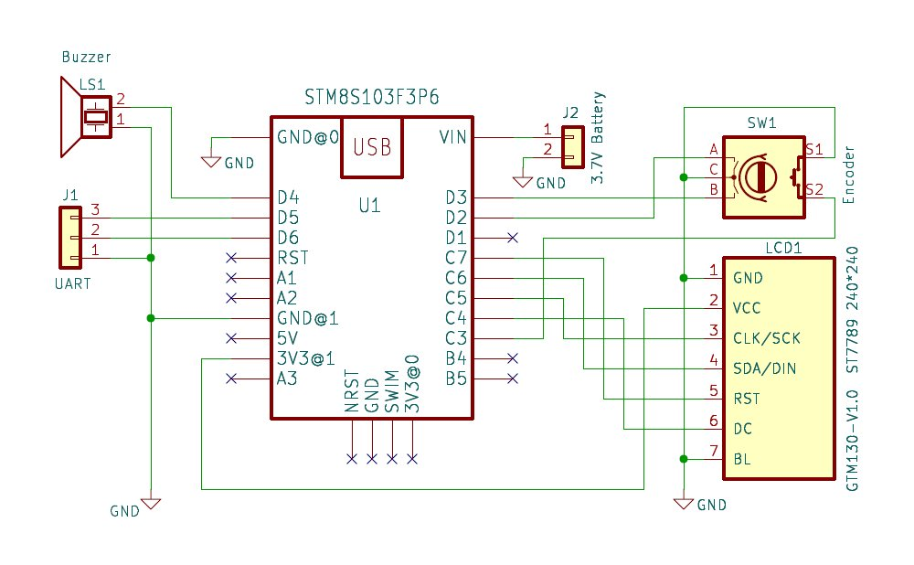

# ST7789-Terminal
***Terminal de lectura UART usando STM8S103F3 con display ST7789 240x240***

### Descripción...

Solía utilizar una NetBook y un adaptador USB-UART(TTL) para ver el log durante el encendido en diferentes aparatos (TVs, impresoras y otros), que cuentan claro!.. con conexión UART. Desafortunadamente se golpeo y se daño el display, así que decidí hacer un lector que sea portatil.

En este proyecto utilizo un modulo genérico con un MCU de ST, el STM8S108F3 que funciona a 8bits y cuenta con muy poca memoria, por lo que el programa es bastante reducido. La lectura se puede ver en un pequeño display ST7789 con una resolución de 240x240 pixeles y se controla mediante un encoder rotativo de 20 pasos por vuelta con pulsador incluido. 

