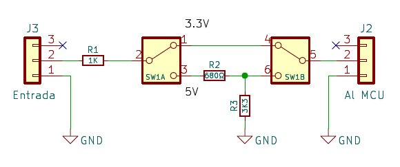
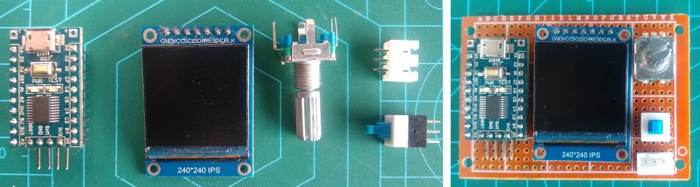
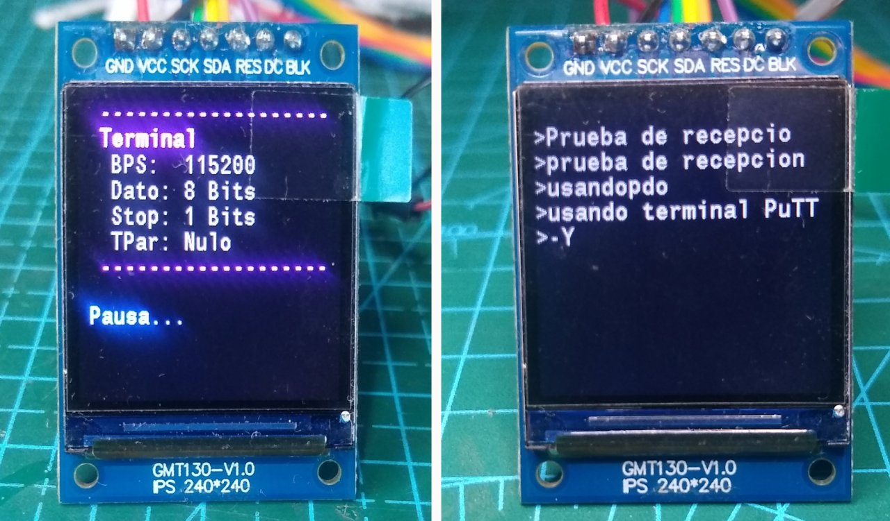

# ST7789-Terminal
***Terminal de lectura UART usando STM8S103F3 con display ST7789 240x240***

### Descripción...

Solía utilizar una NetBook y un adaptador USB-UART(TTL) para ver el log durante el encendido en diferentes aparatos (TVs, impresoras y otros), que cuentan claro!.. con conexión UART. Desafortunadamente se golpeo y se daño el display, así que decidí hacer un lector que sea portatil.

En este proyecto utilizo un modulo genérico con un MCU de ST, el STM8S108F3 que funciona a 8bits, con un precio accesible pero cuenta con muy poca memoria, por lo que el programa es bastante reducido. La lectura se puede ver en un pequeño display ST7789 con una resolución de 240x240 pixeles y se controla mediante un encoder rotativo de 20 pasos por vuelta con pulsador incluido.  
El módulo cuenta con un regulador AMS1117-3.3 lo que permite ser alimentado con una tensión entre 4.75 y 12V. Lo pines VIN y 5V están conectado a la entrada del regulador, mientras que el pin 3.3V está conectado a la salida del mismo y al MCU.  
Seleccione este microcontrolador porque puede operar a 16mz alimentado con 3.3V, y esto es indispensable para que el UART alcance los 115200 baudios a los que operan la mayoría de las placas main de TVs. 

Lo Pines PD5 (TX) y PD6 (RX) tienen diodos de protección internos, pero pueden agregar un resistencia (resistor) de 1k (1000 Ohms) en serie para mayor protección, esto no afectara su normal funcionamiento y en caso de trabajar con señales de 5V limitaran la corriente a no mas de 1.2mA. En este programa solo utilizo el pin PD6 (RX), ya que configuro la interfaz UART como solo recepción de datos.  
Otra opción para trabajar con señales de 5v de forma segura es implementar un divisor resistivo compuesto por un resistencia de 1.5k en serie conectado al pin PD6 y otra de 3.3k que conecte el mismo pin a Vss. Esto también bajara drásticamente la impedancia de entrada para aquellos casos donde tengamos mucha señal de ruido.  
Sin embargo, la mejor opción seria una llave selectora SPDT (doble) y un divisor resistivo para la posición correspondiente a 5V de entrada. R1 siempre estará en serie a la señal de entrada, R2 puede ser de 680Ω o de 720Ω y actúa como parte del divisor resistivo compuesto por R1, R2 y R3. En ésta configuración ya no es necesario utilizar la resistencia de 1K5 que antes propuse.  
Es necesario usar una llave doble para que desconecte el divisor resistivo en la posición "3.3V" y que en la posición de "5V" tome la salida de la unión entre R2 y R3.

------------

### Montaje

Los componentes se pueden montar en un PCB prototipo de 7cm x 5cm con perforaciones cada 2.54mm o 0.1" y sus correspondientes pads de cobre. También pueden optar por un PCB algo mas pequeño del tipo doble faz y montar el modulo STM8S103 en la parte trasera del mismo. Se los dejo a su criterio y preferencias...

El encóder rotativo nos permite acceder al menú y movernos por el a fin de seleccionar sus elementos o propiedades. La función del menú es dejarnos configurar los parámetros de la interfaz UART (Velocidad o BPS, longitud del dato en bits, bits de parada, y tipo de paridad).  
Cuando esta en modo recepción de datos (no en pausa) y se supero las 21 lineas de texto, el encóder nos permite hacer un scroll (despalzamiento vertical) al girar el mismo.  
El switch (pulsador en mi caso), y si optaron por incluir un divisor resistivo, nos permite conmutar entre 3.3 y 5V (amplitud de la señal de entrada). En modo normal solo tendrá R1 en serie (3.3V), una vez pulsado cambia al divisor resistivo (5v).

------------

### Programa

El MCU **STM8S103F3P6** tiene 8Kbytes de Memoria Flash (programa), 1Kbyte de memoria RAM (volatil) y 640Bytes de memoria EEPROM. Debido a estas limitaciones utilizo una única fuente de 11x18 pixeles, esto da un total de 198 pixeles por carácter que se acomodan en 18 pares de bytes. Como hay más de 8 pixeles horizontales (11) se requieren dos bytes por línea, por 18 líneas da un total de 36 bytes por carácter.  
Ahora, si contamos los números del 0 al 9, la letras en mayúscula y en minúscula además de unos 30 símbolos, tenemos un total de 94 caracteres que ocupan unos 3384bytes solo en fuentes.  
**Ya se me fue casi la mitad de la memoria flash.**  Por esta razón las constante las almaceno en la memoria EEPROM

Al iniciar, la configuración por defecto es de 9600 baudios, con una longitud de datos de 8 bit, 1 bit de parada y sin paridad, esto lo muestra en la pantalla inicial. Inicia en modo pausa y para ponerlo en espera de datos hay que presionar el pulsador del encóder una vez.
Mientras esta en modo de espera de datos, si se presiona el pulsador entramos al menú de configuración y lo primero que veremos es "**Baudios**". Al girar el encóder veremos lo demás parámetros de configuración (_Baudios, DataBits, StopBits, Paridad y la opción Salir_) a los que se accede presionando el pulsador del encóder.  

El ST7789 cuenta con la función PTLAR (_Partial Area_) que me permite hacer visible un área horizontal de la pantalla, y gracias a esto solo se ve el item seleccionado del menú.

